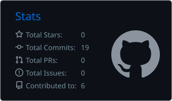
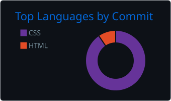

```text
========================================================================
[+] SYSTEM STATUS: ACTIVE
[+] PRIMARY ROLE : Security Analyst & Defensive Engineer
[+] CORE ENGINE  : Vulnerability Management | Web App Security | AD Labs
========================================================================
```

### 🛠️ Technical Arsenal & Telemetry

* **Defensive Auditing:** `Nessus Essentials` | `Greenbone OpenVAS` | `PhishTool`
* **Offensive Emulation:** `Metasploit` | `Ffuf` | `Aircrack-ng` | `Impacket`
* **Threat Intel & OSINT:** `Cisco Talos` | `VirusTotal` | `Abuse.ch`

---

### 📊 GitHub Metrics & Security Operational Stats

<p align="left">
  
  
</p>

---

### 🗄️ Active Framework Deployments

* 🛡️ **[Cyber Shujaa Portfolio](https://github.com/obubalenny/Cyber-Shujaa-Security-Analyst-Portfolio):** 10 detailed assessment logs mapping full-chain laboratory network compromise, container breakout, and AD replication abuse.
* 🛰️ **[Network Recon Lab](https://github.com/obubalenny/metasploitable2-network-recon-lab):** Service verification vectors and modular shell execution records against complex target systems.
* 🌐 **[Personal Portfolio Site](https://obubalenny.github.io):** Technical projects, cybersecurity lab challenges, and professional ICT background.


---

📬 **Secure Shell Handshake:**

<a href="mailto:obubalenny@gmail.com"></a>
<a href="https://linkedin.com/in/obubalenson"></a> 
